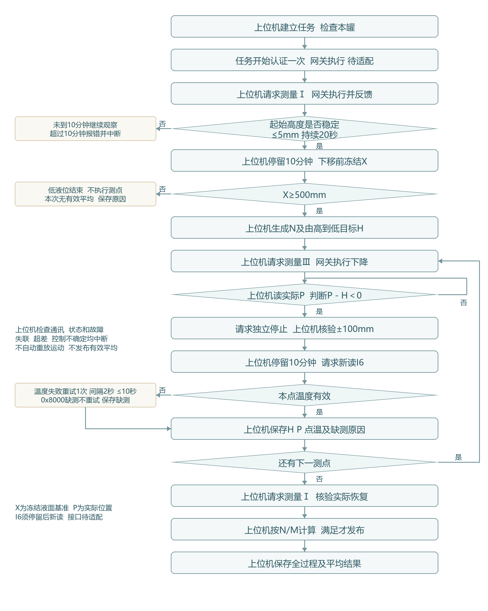

# 上位机经GT6757X无线浮子平均温度测量实施说明

2026-10-19容量修订：每南向COM最多16台，整机64槽位；四南64台仅TCP，三南一北最多48台，两南最多32台。原1～32号绑定不搬移，升级自动扩展槽位并迁移schema3。详见[容量与升级说明27](27_十六台每口扩容与升级说明.md)。

2026-10-14。V1.3职责修订及C01同步：上位机执行完整任务，网关负责采集及单次控制。软件0.3.1命令映射来源和名称已同步；认证边界和新读I6待适配。V1.2原件保留。

## 12 上位机经GT6757X测温的职责和数据

平均测温由上位机完成。上位机负责创建任务、生成测点、判断位置、停留计时、采温重试、计算平均及保存全过程；GT6757X负责液位计采集、缓存和单次控制执行，并向上位机提供数据及控制反馈。厂家负责串口角色、仪表绑定和网关配置。

沿用V1.2确认的I0/I1实际高度、I6浮子温度、测量Ⅲ下降及停止规则。上位机用实际高度P与计划目标H判断停止时机，不要求网关自主测温或另有目标高度写入接口。网关不生成测点计划，不保存整项测温任务状态或计算任务平均。

| 数据或动作 | 网关南向读写 | 上位机用途 |
| --- | --- | --- |
| 实际高度P | FC04 I0/I1，int32，0.1mm | 测量Ⅰ时冻结液面基准X；下降时判断实际浮子位置 |
| 浮子温度 | FC04 I6，int16，0.01℃ | 停留后逐点采温；0x8000为缺测 |
| 仪表平均温度 | FC04 I26，int16，0.01℃ | 现有D2摘要温度；不代替本任务逐点计算平均 |
| 任务开始认证 | FC10 H129=0x10D9 | 每罐每次完整任务仅一次；北向触发方式待适配 |
| 模式和故障 | FC03 H698、FC04 I51/I52 | 核验实际模式、远程状态和故障 |
| 模式切换和停止 | FC10 H699 | 测量Ⅰ0x0001；测量Ⅲ0x0020；停止0x0004 |

按2026-10-13的C01确认，网关和L25测量Ⅲ编号均为3、停止均为4。上表H699值是网关写给液位计的动作位，客户不直接把0x0020写入D2命令寄存器。

## 实施状态和温度名称

当前软件0.3.1已有采集、缓存及D2单次控制。完整平均测温流程由上位机后续适配；网关的每任务一次认证、停留后新读I6也需最小接口适配。C01修订已同步程序及文档；D2地址和操作方式不变。

上位机分别显示浮子温度I6、仪表平均温度IR26和本任务计算平均及完成时间。任务平均按第9节有效点规则计算，不回写I26，不覆盖D2摘要温度。进行中或失败时，旧成功结果必须标明所属任务和时间。

## 13 上位机启动任务和生成测点

### 步骤1 检查本罐并建立任务

上位机核对仪表绑定、站址、远程状态、故障及实际数据，确认无其他控制或未决动作。保存任务ID、仪表编号、选点数及规则版本；运行期间协调同罐控制和配置变更，避免多个客户端同时控制。

### 步骤2 完整任务开始时认证一次

上位机明确发起本次完整任务，网关向该液位计H129写0x10D9一次并反馈。随后通过D2命令1切换测量Ⅰ，查询命令结果及实际模式。已处于测量Ⅰ也须完成本次认证与状态核验。任务内切换、停止、下一点和恢复均不再认证；下一项完整任务重新认证。北向任务开始通知方式待单独适配，不擅自把每条测量Ⅰ命令认作新任务。

### 步骤3 判断起始高度稳定

上位机在实际测量Ⅰ状态下，用具有可确认更新关系的I0/I1读数组成观察窗口，极差不大于5mm并持续20秒判稳定；最长等待10分钟，超时报错且不下降。反复读取同一缓存值不能算多次成功采集；读数失效或更新关系不能确认时，不据此判定稳定。

### 步骤4 起始停留并冻结X

稳定后另停留10分钟，继续检查通讯、模式和故障。起始I6只作基准记录，不计入平均。下降前取得有效高度并冻结为X，保存来源及时间。下降过程中P变化，X保持不变；起始稳定观察和本段停留分开计时。

### 步骤5 上位机生成目标H

X小于500mm不执行测点；500至不足2000mm取1点；2000至不足4000mm最多3点；4000mm及以上最多16点，默认5点。计划N取选择数与上限的较小值。1点取X/2；多点在500mm至X－500mm等距，从高到低执行。

上位机冻结X后保存N和各点H。温度缺测不降低N。低液位退出记录原因，不生成本次有效平均，保留并明确标识旧结果。

## 任务时间

起始停留10分钟加每点停留10分钟，默认5点仅停留合计60分钟，另加稳定观察、移动、停止及恢复时间。浮子速度约2至5mm/s，可用于估算等待时间，不能代替实际位置判断。3秒采集目标、9秒缓存有效窗口均不是任务完成时间。

## 14 上位机逐点控制和计算平均

### 步骤6 请求测量Ⅲ并监测P

上位机通过D2命令3请求测量Ⅲ；网关执行H699=0x0020。查询命令结果并核验实际模式，再持续读取实际P及状态。命令执行结果不明时，不自动重发运动命令；不能用速度、移动时间或目标H代替真实P。

### 步骤7 越过H时请求独立停止

当可确认更新的实际读数P－H小于0，上位机写D2独立停止寄存器。网关执行H699=0x0004，不再认证。上位机读取停止结果和实际状态，确认停稳及最终|P－H|≤100mm。命令回读确认不等于浮子到位；停止和停稳超时在联调中确定，不直接套用起始稳定的5mm/20秒。

### 步骤8 到位停留10分钟后新读I6

从上位机确认停止且到位时开始10分钟停留，期间检查位置、模式、通讯和故障。到时须由网关向液位计新发FC04读取I6，并把本次读取结果交给上位机；当前北向普通读缓存不能触发该操作，接口待适配。读取失败只重试1次，间隔2秒，首次与重试总等待不超过10秒；0x8000直接缺测、不重试。

“新读”指液位计I6读取请求在停留结束后发出，不要求无线温度数值变化，也不增加无线更新时间或采样序号条件。仅温度缺测且位置、控制和通讯仍可确认正常时，保存原因后继续下一点；失联、位置无效、故障、超差或控制不确定时，终止自动推进。

### 步骤9 上位机保存本点并继续

保存点序、H、停止后P、偏差、停留起止、温度读取次数、原值或缺测原因。还有测点时再次请求测量Ⅲ，按相同步骤下降、停止和停留。正常从高到低不插入提升或测量Ⅱ，不重复认证，不因缺测改变N。

### 步骤10 恢复测量Ⅰ并发布结果

上位机用D2命令1请求恢复测量Ⅰ，核验实际模式和高度；本任务不再认证。按第9节N/M门槛判断，满足有效点数量、无终止异常且恢复成功才发布本次有效平均。恢复失败或不确定不标正常完成。

平均分母为有效点数M，不用N，不补0，不加入起始基准温度。门槛为N=1至2时M≥1，3至4时M≥2，5至7时M≥3，8至10时M≥4，11至16时M≥5。上位机保留原始温度精度，记录计算值、完成时间和恢复结果。

## 15 上位机经GT6757X测温流程图

图3 上位机执行完整测温任务 网关提供采集和单次控制

## 16 采集时序和异常处理

默认快速采集仍以3秒为调度目标，先按现有配置联调。浮子速度2至5mm/s，3秒内移动约6至15mm；从数值上看小于±100mm容差，但这不是定位精度保证。实际误差还包括最坏采集间隔、同口排队、上位机轮询和判断、停止指令延迟及机械制动距离。

上位机根据新的实际P判断P－H＜0并请求停止。联调应在最高约5mm/s及每南向口8台负载下，测量实际更新间隔、停止延迟和最终偏差。只有确认满足±100mm，才能认可定位能力；不能仅凭3秒目标或9秒有效窗口认定到位。若不满足，再针对实测瓶颈调整采集或接口，不预设网关自动测温调度器。

每条南向RS485由网关现有串口队列执行，四口角色可配置。上位机安排多罐任务并协调控制，不向网关提交一项需自主运行的平均测温任务。停留计时属于上位机，不占用网关串口锁。

| 情形 | 上位机及网关的处理 |
| --- | --- |
| 温度单点缺测 | 上位机按重试和0x8000规则记录；其他条件正常才继续 |
| 位置无效 超差或仪表故障 | 上位机终止自动推进，按控制可确认程度处理停止并记录；不当作普通温度缺测 |
| 通讯失联 控制结果不明 | 上位机中断任务，不自动重放运动；网关保留现有审计和不确定状态 |
| 人工取消或独立停止 | 上位机取消后续计时和控制，请求独立停止并核验实际状态；停止不明须核查 |
| 上位机断开或重启 | 任务不由网关接管。重新连接先核验实际模式和位置，不自动续跑或补发动作 |
| 网关掉电 重启或升级 | 上位机中断任务；恢复通讯后核验实际状态，不以缓存或服务恢复认定浮子已停 |

上位机离线时，网关正常采集可以继续，但不代表完整测温流程继续或浮子已停止。失去上位机后的运动停止策略须另行定义并上板验证，当前不能承诺已有自动停止功能。软件独立停止不替代现场硬接线急停。

## 记录和恢复

任务ID、测点计划、计时、点记录、平均结果及恢复状态由上位机保存。网关保留现有采集和单次控制审计。上位机使用单调时钟计停留，时间戳记录任务与读数时间；重启后不靠旧计时自动续跑，先人工核查。

## 17 北向接口和后续适配范围

沿用D2三寄存器控制加独立停止，不新增平均测温任务寄存器区。N/M、任务ID、进度、各点明细和任务平均是上位机业务数据。以下地址均为十进制零基地址，n为1至64号液位计；B=1000+24×(n－1)，C=30000+12×(n－1)，D=3000+144×(n－1)。

| 客户读取或控制 | 现有地址和含义 |
| --- | --- |
| 实际位置 | B+4、B+5：I0/I1，有符号32位，按D2字序，÷10得mm |
| 仪表平均温度 | B+6：IR26，按D2缩放；不是逐点浮子温度I6 |
| 浮子温度缓存 | D+6：原始I6，有符号16位，÷100得℃；0x8000缺测，仅为缓存 |
| 状态及故障 | B+9、B+10：IR51、IR52，结合有效位、数据年龄和实际模式判断 |
| 单次控制 | FC06写C+0；FC03读C+1状态、C+2错误；命令1测量Ⅰ，3测量Ⅲ |
| 独立停止 | FC06写C+7=1；FC03读C+8状态、C+9错误，不依赖普通命令区复位 |

D2控制状态3仅表示回读确认，不能表示浮子到位、温度已新读或测温任务完成。普通命令复位遵循D2状态规则；状态5须核查，不自动重发。实际位置使用仍须符合有效性和更新关系，不能只看网关在线。

## 后续两项最小适配

一次认证：当前Engine.Execute每条单次命令写H129，模拟器也按每命令消耗认证。后续须明确由上位机通知完整任务开始，再由网关只认证一次；任务内动作不再认证。普通单次控制兼容、任务结束及中断边界须一起设计；本章不虚构已可使用的北向地址。

新读I6：当前FC03/FC04北向读取仅返回缓存，详细数据默认约30秒采集，不能保证停留结束后10秒内完成新读。后续须提供停留后发起液位计I6读取、返回本次成功或失败及可确认时序的最小机制。它是单次读操作，不是网关测温任务状态机，也不要求无线端新增序号或时间戳。

## 联调和版本说明

检查每完整任务H129恰好写一次；任务内模式切换和独立停止不再认证；停留后I6请求的发送时刻及重试；2至5mm/s、满载下实际P更新和±100mm偏差；有效点门槛、恢复失败、断网及重启处理。保留原D2审计、停止优先及不确定状态处理。

2026-10-14按C01更新命令名称与映射来源，软件0.3.1，D2地址及操作方式不变。保留3秒采集目标，不表示当前程序已经完整满足一次认证与新读I6流程；两项适配另行实施，直连南向动作位保持，IFX命令按最新C01更新。
